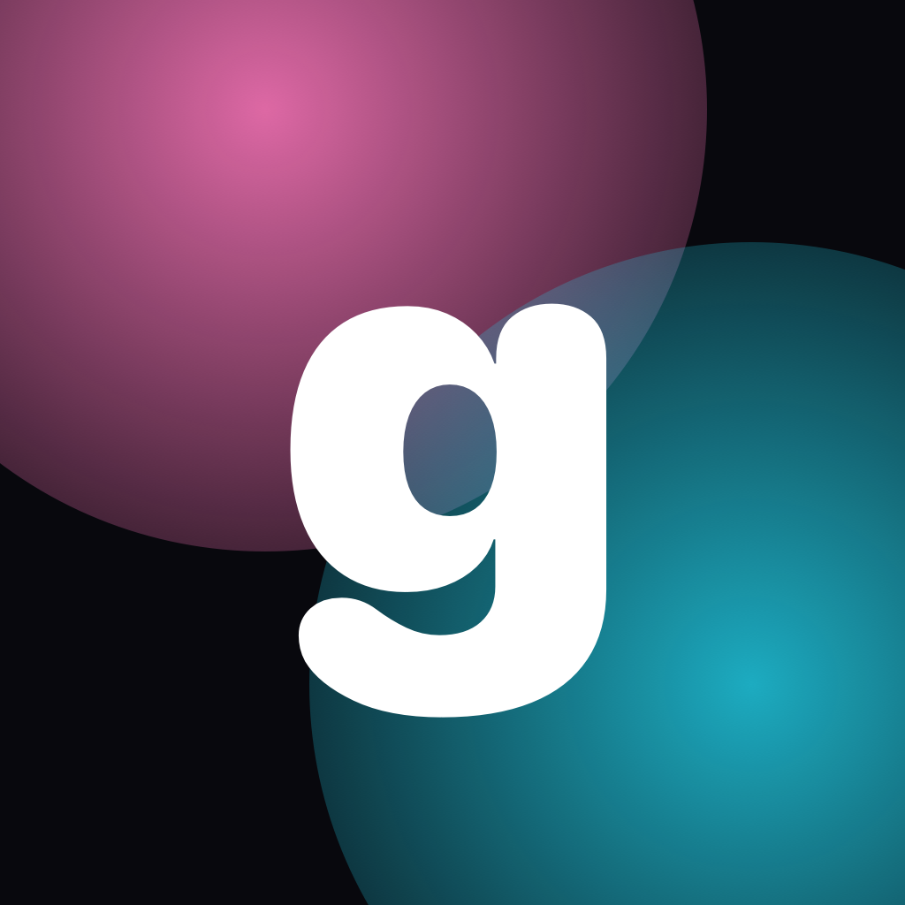
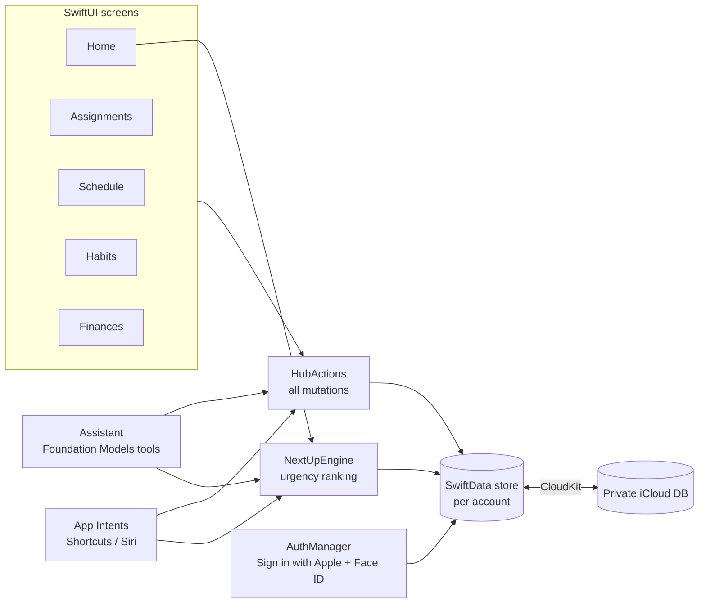

<div align="center">



# gDash

**Your life, one hub.** A private, personal dashboard for iPhone that brings assignments, schedule, habits and money together, with an on-device assistant that can tell you what to do next.


</div>

---

## Features

| Section | What it does |
|---|---|
| **Secure login** | Sign in with Apple, plus a Face ID / passcode lock whenever the app returns from the background. Each account gets its own encrypted store, and the app-switcher snapshot is hidden. |
| **Home** | A glance card for every section: what's due this week, today's schedule, habits not yet logged, spending against budget. An **Up next** card ranks the most urgent thing across everything. |
| **Assignments** | Add, edit, delete, mark complete. A progress bar and slider track how far along you are, with priority levels and overdue warnings. |
| **Schedule** | Today list, plus **Day** timeline, **Month** grid and **Year** overview. Shows events, assignment due dates, bill and credit-card due dates, and habit check-ins, with daily or weekly repeats. |
| **Habits** | Create habits and log them with one tap. Current and best streaks, a priority toggle, a 7-day strip and a 16-week history grid (tap a day to edit it). |
| **Finances** | Monthly budgets by category, bills due soon with one-tap pay (recurring bills roll forward a month), a **money-flow chart** from income to spending categories, and a 6-month cash-flow chart. |
| **Assistant** | Chat with an on-device model (Apple Intelligence) that can add tasks and events, log habits, change budgets, record spending, and decide what you should do next. Falls back to simple commands when Apple Intelligence is unavailable. |
| **Shortcuts & Siri** | Log Habit, Add Assignment, Add Calendar Event, Log Expense or Income, and What Should I Do Next, all usable from the Shortcuts app, Siri or the Action button. |

<!--
## Screenshots

| Home | Schedule | Habits | Finances |
|---|---|---|---|
|  |  |  |  |
-->

## Privacy

- **No server.** Data lives in SwiftData on the device and syncs only to *your* private iCloud database through CloudKit.
- **The assistant runs on the device.** It uses Apple's Foundation Models framework, so prompts and data never leave the phone.
- **Locked by default.** The account ID lives in the Keychain (`ThisDeviceOnly`), Face ID is required on every return to the app, and Shortcuts actions only run while the device is unlocked.

## Requirements

| | |
|---|---|
| Xcode | 26 or later |
| iOS | 26.0+ (iPhone) |
| Apple Developer Program | **Paid membership required** to run on a device. Free "personal teams" can't use iCloud, Sign in with Apple or Push Notifications. |
| Assistant | Optional: an Apple Intelligence–capable iPhone (iPhone 15 Pro or later) with Apple Intelligence turned on. |

## Getting started

```bash
git clone https://github.com/<your-username>/gDash.git
```

```bash
open gDash/gDash.xcodeproj
```

1. Select the **gDash** target → **Signing & Capabilities** and choose your paid team.
2. If `com.caden.gDash` is taken, change the bundle ID, and change the iCloud container to `iCloud.<your bundle id>` (in the capability **and** in `gDash/gDash.entitlements`).
3. Pick a simulator or your iPhone and press **Run**.

### Trying it in the Simulator

Sign in with Apple doesn't work in most simulators, so Debug builds add two helpers:

- **Use local test account** on the login screen
- **Load sample data** in the profile menu (top-right avatar on Home), which fills every screen with realistic data

## Shortcuts

Search **gDash** in the Shortcuts app. Example phrases:

| Action | Siri phrase |
|---|---|
| Log Habit | "Log Workout in gDash" |
| Add Assignment | "Add a task to gDash" |
| Add Calendar Event | "Add an event to gDash" |
| Log Expense or Income | "Log spending in gDash" |
| What Should I Do Next | "Ask gDash what's next" |

**What Should I Do Next** also returns the item's title as text, so you can pass it to other actions (e.g. show a notification or start a Focus).

## Architecture



The UI, the assistant and Shortcuts all make changes through **`HubActions`**, so adding a task from Siri behaves exactly like adding it in the app. **`NextUpEngine`** scores every open item to answer "what should I do next?". It weighs deadlines against remaining progress, priority habits, streaks at risk, upcoming events and overdue bills.

### Project layout

```
gDash/
├── App/           App entry, root view, lock and unlock flow
├── Auth/          Sign in with Apple, Face ID, Keychain, login + lock screens
├── Data/          SwiftData models, DataStore, HubActions, NextUpEngine, sample data
├── Home/          Menu screen with a glance card per section
├── Assignments/   List, progress tracking, editor
├── Schedule/      Today / Day / Month / Year views, unified calendar feed, add sheet
├── Habits/        Habit list, streaks, history grid, editor
├── Finances/      Budgets, bills, money-flow (Sankey) and cash-flow charts
├── Assistant/     Chat UI, Foundation Models tools, offline command mode
├── Intents/       App Intents + App Shortcuts
└── Theme/         Colors, typography, glass components
```

## Tech stack

- **SwiftUI** with iOS 26 Liquid Glass (`glassEffect`), `MeshGradient` backgrounds
- **SwiftData** with **CloudKit** sync (CloudKit-compatible schema: default values on every property, optional relationships)
- **AuthenticationServices** (Sign in with Apple) and **LocalAuthentication** (Face ID)
- **FoundationModels** with tool calling for the assistant
- **App Intents** for Shortcuts and Siri
- **Swift Charts** and a custom `Canvas` Sankey diagram; chart colors checked for color-blind safety and contrast on the dark background

## Troubleshooting

<details>
<summary><b>"Personal development teams … do not support the iCloud, Sign In with Apple, and Push Notifications capabilities"</b></summary>

You're signing with a free Apple ID. Join the [Apple Developer Program](https://developer.apple.com/programs/enroll/), then pick the paid team in Signing & Capabilities.
</details>

<details>
<summary><b>"The capability associated with ICLOUD could not be determined"</b></summary>

Remove the **iCloud** capability (trash icon) and add it again with **+ Capability → iCloud**. Tick **CloudKit** and select `iCloud.com.caden.gDash`, then click **Try Again**. If that still fails, create the iCloud container and App ID on the [developer portal](https://developer.apple.com/account/resources/identifiers/list) first.
</details>

<details>
<summary><b>The assistant says it's in "command mode"</b></summary>

Apple Intelligence is unavailable: the device isn't eligible, it's turned off, or the model is still downloading. The assistant still understands commands like `what next`, `log Workout`, `add task Essay draft`, `spent 12 on Dining` and `budget Groceries 300`.
</details>

## Roadmap ideas

- [ ] Home Screen and Lock Screen widgets
- [ ] Reminders and notifications for due dates and habit check-ins
- [ ] Import from Apple Calendar / Reminders
- [ ] iPad layout
